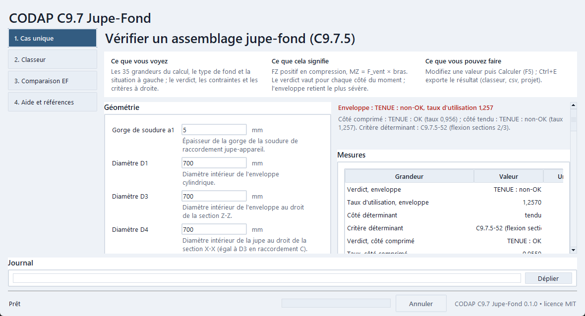

# CODAP C9.7 Jupe-Fond

CODAP C9.7.5 verification of skirt-head assemblies and comparison with an FE reference.

Python desktop application by Philippe Amuzuga, for Python 3.11 to 3.13 (64-bit, with Tk).

[Français](README.md) · [User guide](USER_GUIDE.md) · [Versions](CHANGELOG.md)

## Installation

Download the repository (Code button, Download ZIP) or, when a version is published in [Releases](https://github.com/Philippe-AMUZUGA/codap-c-97-jupe-fond/releases), the archive of that version, then extract all files into a writable folder.

Python 3.11 to 3.13 (64-bit, with Tk) must already be installed: [python.org](https://www.python.org/downloads/). The launcher never installs Python. It creates a local environment in `.runtime` and installs the libraries of `requirements.txt` there. The first installation needs an Internet connection unless wheels are supplied in `vendor/wheels`; later launches download nothing.

Keep the launcher together with `src`, `outils` and the dependency files. Do not run the application from an archive you have not extracted.

## Launch

On Windows, double-click `Lancer_CodapC97JupeFond.bat` each time you use the application, or, in PowerShell from the extracted folder:

```powershell
.\Lancer_CodapC97JupeFond.bat
```

On Linux, run `sh lancer_codap-c-97-jupe-fond.sh` from the extracted folder (install the `python3-tk` package on Debian and Ubuntu). On macOS, double-click `lancer_codap-c-97-jupe-fond.command` after granting execute permission once in Terminal: `chmod +x lancer_codap-c-97-jupe-fond.command`; on first launch, macOS may ask for permission (right-click, Open).

Screens, units and shortcuts are described in the [user guide](USER_GUIDE.md).

## Trial mode

The `-t` mode replays the whole path without any user action (values of `examples/exemple.json`, calculation, export, interface) and exits with code 0 when everything succeeds. It opens no connection and writes only to a temporary folder.

```powershell
.\Lancer_CodapC97JupeFond.bat -t
$LASTEXITCODE
```

A nonzero code indicates failure: read the displayed message and the log before [reporting a bug](https://github.com/Philippe-AMUZUGA/codap-c-97-jupe-fond/issues/new/choose).

## Without a window

`python -m codap_c_97_jupe_fond.cli examples/exemple.json -o folder`, run with the `.runtime` environment or a development environment, computes from an input file and exports the results.

## Data and privacy

Preferences are stored in `%APPDATA%\CodapC97JupeFond` and the log in `%LOCALAPPDATA%\CodapC97JupeFond\journaux` (on Linux and macOS: the user's configuration and state folders, defined in `src/codap_c_97_jupe_fond/systeme/chemins.py`). Nothing is written to the program folder, apart from `.runtime`. Exports go to the folder chosen during export. `.runtime` holds the Python environment, not your exports: back up your data before uninstalling.

The application opens no network connection. Only the installation of the libraries needs one, through pip; the Help menu opens the Releases page in your browser, on your click. Calculations, preferences and exports stay on your computer. The repository and its forms are external services that you open yourself: remove names, personal paths and sensitive values from logs or screenshots before sharing them.

## What the application does

Four tabs, opened in any order (Ctrl+1 to Ctrl+4):

1. **Single case**: the 35 quantities of C9.7.5, the head type (Korbbogen or elliptical) and the situation; Calculate (F5) gives R1 to R7, the Cij coefficients with δ1, δ2 and λ1, the twelve stresses of the three sections, the three criteria, the utilisation ratio and the verdict "TENUE : OK" or "TENUE : non-OK" for the compressed side, the tensile side and the envelope; a configuration outside the C9.A6 domain or the type C joint conditions is flagged. Export to xlsx, csv and projet.json (Ctrl+E).
2. **Workbook**: an `input_CODAP.xlsx` workbook calculated as a batch, or an FE geometry workbook (`input_EF.xlsx`) first converted by the original program chain; row-by-row summary, then `output_CODAP.xlsx` and `journal_CODAP.txt`.
3. **FE comparison**: from your own FE reference files, two confusion matrices against FE, CODAP C9.7.5 and a compared rule, with their metrics; export to xlsx, csv and png.
4. **Help and references**: scope, mechanical conventions, validation and references.



Screenshots of the four tabs, in light and dark themes, are in [docs/images](docs/images).

## Mechanical conventions

- FZ is positive in compression; no pressure end effect is added to FZ (it is carried by C71·R1).
- MZ = F_wind × lever arm; the lever arm is 2H by default in the FE comparison and can be set (Workbook and FE comparison tabs).
- The GRC head of the FE models is treated as a Korbbogen (or elliptical) head: this has no code value, as C9.7.2.1 restricts GRC heads to type AB joints.
- The test situation has no thermal effects (R5 = R6 = R7 = 0).
- Defaults in the FE comparison: f = fj = 150 MPa, E = 210,000 MPa, FE threshold 225 MPa (1.5 f).
- Scope: complete C9.7.5; C9.7.6 in the calculation library, not exposed; C9.7.7 out of scope; type AB joint not implemented.

## Comparing with an FE reference

The application ships no study data: you bring your own. Place two CSV files in the folder shown by the "FE comparison" tab (by default, the `etude` subfolder of the application data folder), or point to another folder with the `CODAPC97JUPEFOND_ETUDE` environment variable:

- `ef_unitaires.csv`: one row per configuration, with the columns `index`, `e`, `D1`, `H`, `ALPHA`, `R1`, `R2`, `H3`, `D3` (geometry) and, for each of the three unit cases `P` (pressure), `T` (external force) and `W` (wind), the linearised Tresca stresses `{P,T,W}_TRESCA_LIN_{Z1,Z2,Z3}_{R,L}`;
- `contingency_per_case.csv`: `index`, `sigma_ref` (recomputed reference stress), `classe_regle` (`R` resistant, `D` failing) for the rule you compare.

The `examples/etude_exemple` folder holds two synthetic files of 24 cases, with invented values and no mechanical meaning: they show the format and let you try the tab (`python outils/generer_exemples.py` regenerates them). The "Run the comparison" button combines the three unit cases (1.2 MPa, 15 kN and 20 kN), takes the maximum linearised Tresca stress of zones Z1 to Z3 on both sides, compares it with a threshold (225 MPa = 1.5 f by default), calculates the same configurations with C9.7.5 and shows two confusion matrices against FE with their metrics. Positive: configuration resistant according to FE.

## Validation of the calculation

The C9.7.5 calculation is that of the original program, copied unchanged into `src/codap_c_97_jupe_fond/core/source/` with the SHA-256 hash of each file; the application only calls it and arranges its outputs.

| Check | Method | Result |
|:-|:-|:-|
| Tests of the original program | 45 unit and pipeline tests, replayed by `tests/test_noyau_origine.py` | 45 passed |
| Tabulated coefficients of the elliptical head (28) | comparison with the historical 2022 program, 117 configurations, tolerance 1e-12 | passed for 27; C92 differs on purpose (see below) |
| R1 to R7 chain, 12 stresses, criteria C9.7.5-31 to -52 | independent reimplementation written from the CODAP pages alone, more than 900 configurations × 2 sides | maximum relative deviation 9e-13; identical verdicts; one reading reservation on C9.7.5-27 (partly hidden subscript, same reading C73·R3 in both codes) |
| Tables C9.A6.5 against the printed pages | check of the 1,898 values, each deviation checked again under magnification | one sign error corrected: C26, x³ term of C9.A6.5.2.6-9 and -11 (+0.598), no effect for a type C joint (δ2 = 1) |
| Inconsistencies of the printed text | magnification of the pages concerned | C92: -5 (+0.056) and -23 (−0.039) contradict their neighbours; for δ2 = 1 the constant −0.039 is adopted (two independent calculations): only σmy3 changes, no verdict changes on the configurations tried |
| Equation C9.7.5-2 | reading of the page | factor 2 of R2 = 2 FZ / (π D3 eu1) confirmed |
| Verification and validation on seven cases | five type C joints (elliptical head) from a specialised program and two cases from an independent calculation note, replayed; 41 Cij, R1 to R7 and 12 stresses per side compared | δ1 ≤ 1: agreement to the printing precision, identical verdicts; δ1 = 1.10: six Cij deviate by 3 % at most, identical verdict. Details: `docs/VERIFICATION_VALIDATION.md` |

Not checked, being outside the programmed scope (type AB joint, C9.7.7): C28, C29, C210, C38, C39, C310, C58 to C510, C88 to C810, C98, K1 and K2.

## License

Code distributed under the MIT license, copyright 2026 Philippe Amuzuga: see [LICENSE](LICENSE). The libraries used keep their own licenses, listed in [THIRD_PARTY_NOTICES.md](THIRD_PARTY_NOTICES.md).

## Contributions and links

Read [CONTRIBUTING.md](CONTRIBUTING.md) before proposing a change. Use the [forms](https://github.com/Philippe-AMUZUGA/codap-c-97-jupe-fond/issues/new/choose) for a bug or an idea. Report a vulnerability through the private channel described in [SECURITY.md](SECURITY.md). [CITATION.cff](CITATION.cff) provides citation information; the [repository](https://github.com/Philippe-AMUZUGA/codap-c-97-jupe-fond) contains the sources.

