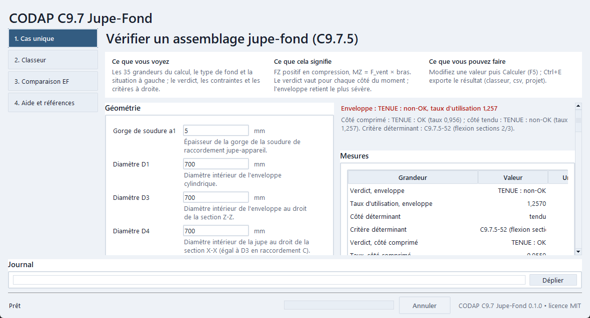
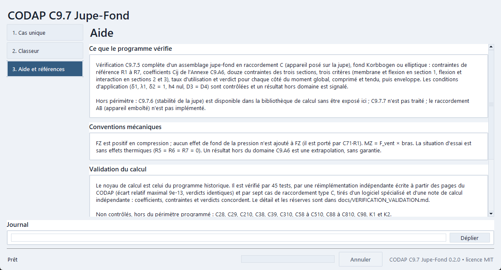

# CODAP C9.7 Jupe-Fond

Vérification CODAP C9.7.5 des assemblages jupe-fond et comparaison à une référence EF

Application de bureau Python de Philippe Amuzuga, pour Python 3.11 à 3.13 (64 bits, avec Tk).

[English](README.en.md) · [Guide utilisateur](USER_GUIDE.md) · [Versions](CHANGELOG.md)

## Installation

Téléchargez le dépôt (bouton Code, Download ZIP) ou, lorsqu’une version est publiée dans les [Releases](https://github.com/Philippe-AMUZUGA/codap-c-97-jupe-fond/releases), l’archive de cette version, puis extrayez tous les fichiers dans un dossier accessible en écriture.

Python 3.11 à 3.13 (64 bits, avec Tk) doit déjà être installé : [python.org](https://www.python.org/downloads/). Le lanceur n’installe jamais Python. Il crée un environnement local dans `.runtime` et y installe les bibliothèques de `requirements.txt`. La première installation demande une connexion Internet, sauf si des roues sont fournies dans `vendor/wheels` ; les lancements suivants ne téléchargent rien.

Conservez le lanceur avec les dossiers `src`, `outils` et les fichiers de dépendances. Ne lancez pas l’application depuis l’archive ouverte sans l’avoir extraite.

## Lancement

Sous Windows, double-cliquez sur `Lancer_CodapC97JupeFond.bat` à chaque utilisation, ou, dans PowerShell depuis le dossier extrait :

```powershell
.\Lancer_CodapC97JupeFond.bat
```

Sous Linux, lancez `sh lancer_codap-c-97-jupe-fond.sh` depuis le dossier extrait (paquet `python3-tk` à installer sous Debian et Ubuntu). Sous macOS, double-cliquez sur `lancer_codap-c-97-jupe-fond.command` après avoir donné une fois le droit d'exécution dans le Terminal : `chmod +x lancer_codap-c-97-jupe-fond.command` ; au premier lancement, macOS peut demander une autorisation (clic droit, Ouvrir).

Les écrans, unités et raccourcis sont décrits dans le [guide utilisateur](USER_GUIDE.md).

## Mode d’essai

Le mode `-t` rejoue sans geste tout le parcours (valeurs de `examples/exemple.json`, calcul, export, interface) et se termine avec le code 0 si tout a réussi. Il n’ouvre aucune connexion et écrit seulement dans un dossier temporaire.

```powershell
.\Lancer_CodapC97JupeFond.bat -t
$LASTEXITCODE
```

Un code différent de zéro indique un échec : lisez le message affiché et le journal avant de [signaler une anomalie](https://github.com/Philippe-AMUZUGA/codap-c-97-jupe-fond/issues/new/choose).

## Sans fenêtre

`python -m codap_c_97_jupe_fond.cli examples/exemple.json -o dossier`, lancé avec l’environnement `.runtime` ou un environnement de développement, calcule depuis un fichier d’entrées et exporte les résultats.

## Données et confidentialité

Les préférences sont rangées dans `%APPDATA%\CodapC97JupeFond` et le journal dans `%LOCALAPPDATA%\CodapC97JupeFond\journaux` (sous Linux et macOS : dossiers de configuration et d’état de l’utilisateur, définis dans `src/codap_c_97_jupe_fond/systeme/chemins.py`). Rien n’est écrit dans le dossier du programme, hors `.runtime`. Les exports vont dans le dossier choisi lors de l’export. `.runtime` contient l’environnement Python, pas vos exports : sauvegardez vos données avant une désinstallation.

L’application n’ouvre aucune connexion réseau. Seule l’installation des bibliothèques en demande une, par pip ; le menu Aide ouvre la page des Releases dans votre navigateur, sur votre clic. Les calculs, préférences et exports restent sur votre poste. Le dépôt et ses formulaires sont des services externes que vous ouvrez vous-même : retirez les noms, chemins personnels et valeurs sensibles des journaux ou captures avant de les partager.

## Ce que fait l'application

Quatre onglets, ouverts dans l'ordre de votre choix (Ctrl+1 à Ctrl+4) :

1. **Cas unique** : les 35 grandeurs de C9.7.5, le type de fond (Korbbogen ou elliptique) et la situation ; Calculer (F5) donne R1 à R7, les coefficients Cij avec δ1, δ2 et λ1, les douze contraintes des trois sections, les trois critères, le taux d'utilisation et le verdict « TENUE : OK » ou « TENUE : non-OK » pour le côté comprimé, le côté tendu et l'enveloppe ; une configuration hors du domaine C9.A6 ou des conditions du raccordement C est signalée. Export en xlsx, csv et projet.json (Ctrl+E).
2. **Classeur** : un classeur `input_CODAP.xlsx` calculé par lot, ou un classeur de géométrie EF (`input_EF.xlsx`) d'abord converti par la chaîne du programme d'origine ; synthèse ligne par ligne, puis `output_CODAP.xlsx` et `journal_CODAP.txt`.
3. **Comparaison EF** : à partir de vos propres fichiers de référence EF, deux matrices de confusion contre l'EF, CODAP C9.7.5 et une règle comparée, avec leurs métriques ; export xlsx, csv et png.
4. **Aide et références** : périmètre, conventions mécaniques, validation et références.





Les captures des quatre onglets, en thème clair et sombre, sont dans [docs/images](docs/images).

## Conventions mécaniques

- FZ est positif en compression ; aucun effet de fond de la pression n'est ajouté à FZ (il est porté par C71·R1).
- MZ = F_vent × bras ; le bras vaut 2H par défaut dans la comparaison EF et se règle (onglets Classeur et Comparaison EF).
- Le fond GRC des modèles EF est traité en Korbbogen (ou elliptique) : ce traitement n'a aucune valeur réglementaire, C9.7.2.1 réservant le GRC au raccordement AB.
- La situation d'essai est sans effets thermiques (R5 = R6 = R7 = 0).
- Par défaut dans la comparaison EF : f = fj = 150 MPa, E = 210 000 MPa, seuil EF 225 MPa (1,5 f).
- Périmètre : C9.7.5 complet ; C9.7.6 dans la bibliothèque de calcul, non exposé ; C9.7.7 hors périmètre ; raccordement AB non implémenté.

## Comparer à une référence EF

L'application ne livre aucune donnée d'étude : vous apportez la vôtre. Déposez deux fichiers CSV dans le dossier affiché par l'onglet « Comparaison EF » (par défaut, le sous-dossier `etude` du dossier de données de l'application), ou désignez un autre dossier par la variable d'environnement `CODAPC97JUPEFOND_ETUDE` :

- `ef_unitaires.csv` : une ligne par configuration, avec les colonnes `index`, `e`, `D1`, `H`, `ALPHA`, `R1`, `R2`, `H3`, `D3` (géométrie) et, pour chacun des trois cas unitaires `P` (pression), `T` (effort extérieur) et `W` (vent), les contraintes de Tresca linéarisées `{P,T,W}_TRESCA_LIN_{Z1,Z2,Z3}_{R,L}` ;
- `contingency_per_case.csv` : `index`, `sigma_ref` (contrainte de référence recalculée), `classe_regle` (`R` résistante, `D` défaillante) pour la règle que vous comparez.

Le dossier `examples/etude_exemple` contient deux fichiers synthétiques de 24 cas, aux valeurs inventées et sans sens mécanique : ils montrent le format et permettent d'essayer l'onglet (`python outils/generer_exemples.py` les régénère). Le bouton « Lancer la comparaison » combine les trois cas unitaires (1,2 MPa, 15 kN et 20 kN), prend la contrainte de Tresca linéarisée maximale des zones Z1 à Z3 des deux côtés, la compare à un seuil (225 MPa = 1,5 f par défaut), calcule les mêmes configurations par C9.7.5 et affiche deux matrices de confusion contre l'EF avec leurs métriques. Positif : configuration résistante selon l'EF.

## Validation du calcul

Le calcul C9.7.5 est celui du programme d'origine, copié sans modification dans `src/codap_c_97_jupe_fond/core/source/` avec l'empreinte SHA-256 de chaque fichier ; l'application ne fait que l'appeler et ranger ses sorties.

| Contrôle | Méthode | Résultat |
|:-|:-|:-|
| Tests du programme d'origine | 45 tests unitaires et de chaîne, rejoués par `tests/test_noyau_origine.py` | 45 réussis |
| Coefficients tabulés du fond elliptique (28) | confrontation au programme historique de 2022, 117 configurations, tolérance 1e-12 | réussi pour 27 ; C92 diffère volontairement (voir plus bas) |
| Chaîne R1 à R7, 12 contraintes, critères C9.7.5-31 à -52 | réimplémentation indépendante écrite à partir des seules pages du CODAP, plus de 900 configurations × 2 côtés | écart relatif maximal 9e-13 ; verdicts identiques ; une réserve de lecture sur C9.7.5-27 (indice en partie masqué, même lecture C73·R3 dans les deux codes) |
| Tables C9.A6.5 contre les pages imprimées | relecture des 1 898 valeurs, chaque écart revérifié par agrandissement | une erreur de signe corrigée : C26, terme en x³ de C9.A6.5.2.6-9 et -11 (+0,598), sans effet en raccordement C (δ2 = 1) |
| Incohérences du texte imprimé | agrandissement des pages concernées | C92 : -5 (+0,056) et -23 (−0,039) contredisent leurs voisines ; pour δ2 = 1, constante −0,039 adoptée (deux calculs indépendants) : seul σmy3 change, aucun verdict modifié sur les configurations essayées |
| Équation C9.7.5-2 | relecture de la page | facteur 2 de R2 = 2 FZ / (π D3 eu1) confirmé |
| Vérification et validation sur sept cas | cinq cas type C (fond elliptique) d'un logiciel spécialisé et deux cas d'une note de calcul indépendante, rejoués ; 41 Cij, R1 à R7 et 12 contraintes par côté comparés | δ1 ≤ 1 : concordance à la précision d'impression, verdicts identiques ; δ1 = 1,10 : six Cij s'écartent de 3 % au plus, verdict identique. Détail : `docs/VERIFICATION_VALIDATION.md` |

Non contrôlés, car hors du périmètre programmé (raccordement AB, C9.7.7) : C28, C29, C210, C38, C39, C310, C58 à C510, C88 à C810, C98, K1 et K2.

## Licence

Code distribué sous licence MIT, copyright 2026 Philippe Amuzuga : voir [LICENSE](LICENSE). Les bibliothèques utilisées gardent leurs propres licences, recensées dans [THIRD_PARTY_NOTICES.md](THIRD_PARTY_NOTICES.md).

## Contribution et liens

Lisez [CONTRIBUTING.md](CONTRIBUTING.md) avant de proposer une modification. Utilisez les [formulaires](https://github.com/Philippe-AMUZUGA/codap-c-97-jupe-fond/issues/new/choose) pour une anomalie ou une idée. Signalez une faille par le canal privé décrit dans [SECURITY.md](SECURITY.md). [CITATION.cff](CITATION.cff) fournit les informations de citation ; le [dépôt](https://github.com/Philippe-AMUZUGA/codap-c-97-jupe-fond) contient les sources.

